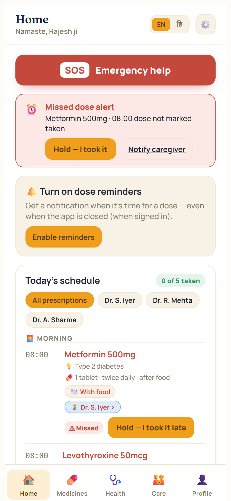
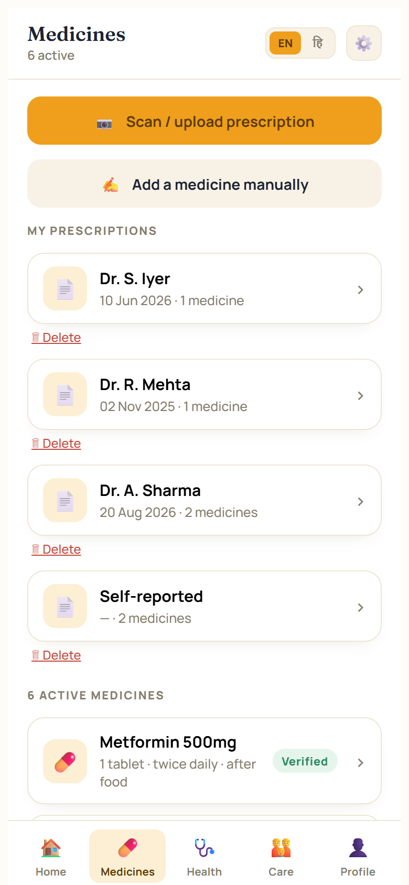
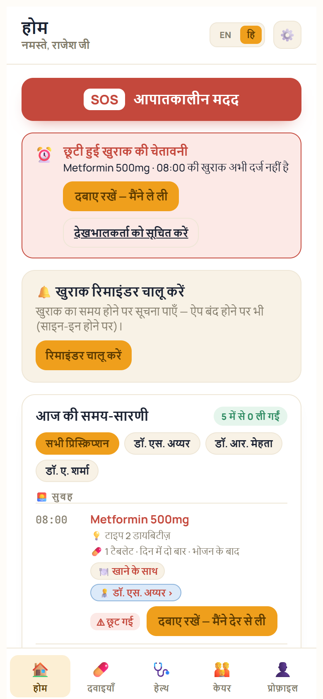

# PharmaSaathi AI

**A bilingual (English / Hindi) medicine companion for patients and caregivers in India.** Scan a prescription, understand each medicine in plain words, get reminders on your phone even when the app is closed, and get warned about risky doses or duplicate medicines. You can also ask questions by voice.

**Live app:** [divyanshibajpai2007.github.io/pharmasaathi-ai](https://divyanshibajpai2007.github.io/pharmasaathi-ai/). Tap **"Try with sample data"** to explore without an account; nothing is saved.

<p>
  
  
  
</p>

> ⚠️ PharmaSaathi helps people organise and understand their medicines. **It is not medical advice.** The AI features only ever *add* warnings for a pharmacist or doctor to check; they never say a medicine is safe or tell anyone to change a dose.

## The problem

Elderly patients and their families often juggle several prescriptions from different doctors, handwritten in English, with no clear schedule. Doses get missed or doubled, and dangerous combinations go unnoticed. Most medicine apps are English-only and assume you type everything in. PharmaSaathi is built for a Hindi-speaking family managing a parent's medicines from a phone.

## Features

- **Prescription scanning:** photograph a (possibly handwritten) prescription. An AI vision model reads it into a structured list of medicines, with on-device OCR (Tesseract.js) as a fallback. It warns you if you scan the same prescription twice.
- **Plain-language medicine info in English and Hindi:** what each medicine is for, how to take it, food timing, and interaction warnings.
- **Safety checks:** built-in dose limits and interaction rules, plus an **AI second opinion** on daily doses for medicines with no limit on file. AI can only add a warning, never remove one.
- **AI prescription review (draft):** for the patient's age group (child, adult or older adult), flags misread names, unusual doses, duplicates and interactions as a draft for a pharmacist to verify.
- **Phone reminders when the app is closed:** Web Push notifications sent by a scheduled server job every minute. Dose confirmation uses hold-to-confirm, a 30-minute window, undo, and a history of every dose.
- **"Ask PharmaSaathi" voice assistant:** speak in English, Hindi or Hinglish and hear the answer read aloud. It uses the browser's built-in speech tools, with optional cloud speech-to-text and text-to-speech.
- **Care team:** caregivers and pharmacists can connect by QR code. Pharmacists get a review page, and missed doses can notify a caregiver.
- **Installable app (PWA)** with an SOS emergency button.

## Architecture

```
 Phone (PWA: index.html + sw.js)
   │  Supabase JS client · Tesseract.js OCR · Web Speech API · Web Push
   ▼
 Supabase
   ├─ Auth (email sign-in)
   ├─ Postgres: 23 tables with row-level security (43 policies)
   ├─ Edge Functions (Deno / TypeScript); every AI/voice key lives ONLY here
   │    read-prescription     photo → structured medicine list (vision model)
   │    dose-check            AI second opinion on a daily dose (warnings only)
   │    prescription-review   draft review for a pharmacist to verify
   │    voice-stt / voice-tts speech ↔ text (provider set by env vars)
   │    send-reminders        finds due doses and sends Web Push notifications
   └─ pg_cron: calls send-reminders every minute
```

**Design decisions:**
- **No API key ever ships in the app.** The front end calls Edge Functions with the user's sign-in token, and the functions hold the keys as Supabase secrets.
- **Minimal data to the AI.** The dose check receives only a generic medicine name, the amount and the doses per day, with no patient name or ID. The prescription review also gets only the age group.
- **AI can warn but not reassure.** An AI "no problem found" is never shown as a safety confirmation; PharmaSaathi's own rule-based checks are always shown alongside it.
- **Provider-agnostic AI and voice.** Gemini or Anthropic for vision and review, and OpenAI, Google or Gemini for speech, all chosen with environment variables, so the free tier works for demos.

## Evaluating prescription reading

`tools/eval_prescriptions.mjs` runs a folder of prescription photos through the vision model and writes a side-by-side `results.html` (photo on the left, what the AI read on the right) plus `results.json`, so reading accuracy can be scored by eye on real, messy prescriptions instead of trusting a few demo photos.

```powershell
$env:GEMINI_API_KEY = "your-key"
node tools/eval_prescriptions.mjs "C:\path\to\prescription\photos" 20
```

## Repository layout

```
index.html          the whole patient app (single-file PWA)
pharmacist.html     pharmacist preview page
sw.js, manifest.json  service worker (offline + push) and install manifest
backend/
  schema.sql, seed.sql            core tables and a starter medicine catalog (EN + HI)
  care_network.sql, dose_events.sql, pharmacist_reviews.sql,
  prescriptions_diagnosis.sql     feature tables
  push.sql, push_cron.sql         push subscriptions and the every-minute reminder job
  functions/<name>/index.ts       the six Edge Functions
  functions/SETUP_*.md            step-by-step setup for each feature
tools/
  eval_prescriptions.mjs          prescription-reading evaluation
  make_vapid_keys.mjs             generates the Web Push key pair
```

## Run your own copy

1. Create a Supabase project. In the SQL Editor run `backend/schema.sql`, then `seed.sql`, then the other `.sql` files.
2. Deploy the Edge Functions in `backend/functions/` and add their secrets. Each `SETUP_*.md` explains which keys are needed and the free options.
3. Set `SUPABASE_URL` and `SUPABASE_KEY` (the anon key) in `index.html`, and `VAPID_PUBLIC_KEY` from `tools/make_vapid_keys.mjs`.
4. Serve the folder over HTTPS (for example GitHub Pages). Voice and push notifications need HTTPS.

## Built by

Divyanshi Bajpai, B.Tech CSE (AI), MPGI Kanpur. First pitched at Ideathon'26 (IEEE PELS, SBC & WIE, HBTU Kanpur).
